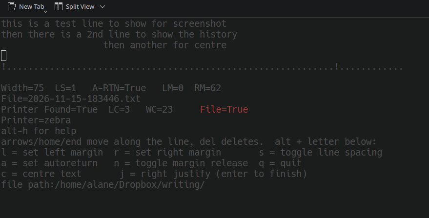

# typewriter

write to a line printer like a typewriter: type a line, press enter, and
it goes to a file and/or the printer (an epson ESC/POS dot matrix or a
zebra GK420d thermal printer).

there are two versions with the same keys and screen:

- [`python/`](./python/README.md): the original, using curses
- [`rust/`](./rust/README.md): a port that builds to a single binary, no venv needed

each folder has its own `config.toml` and bell sounds.

```
cd python && venv/bin/python type2.py        # see python/README.md for setup
cd rust && cargo build --release && target/release/typewriter
```


